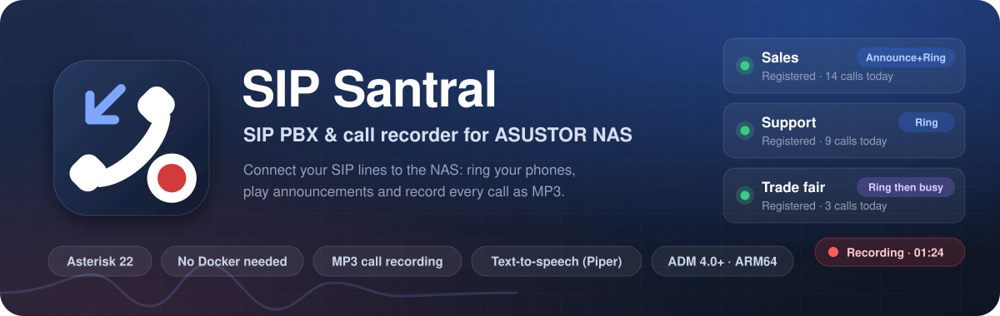
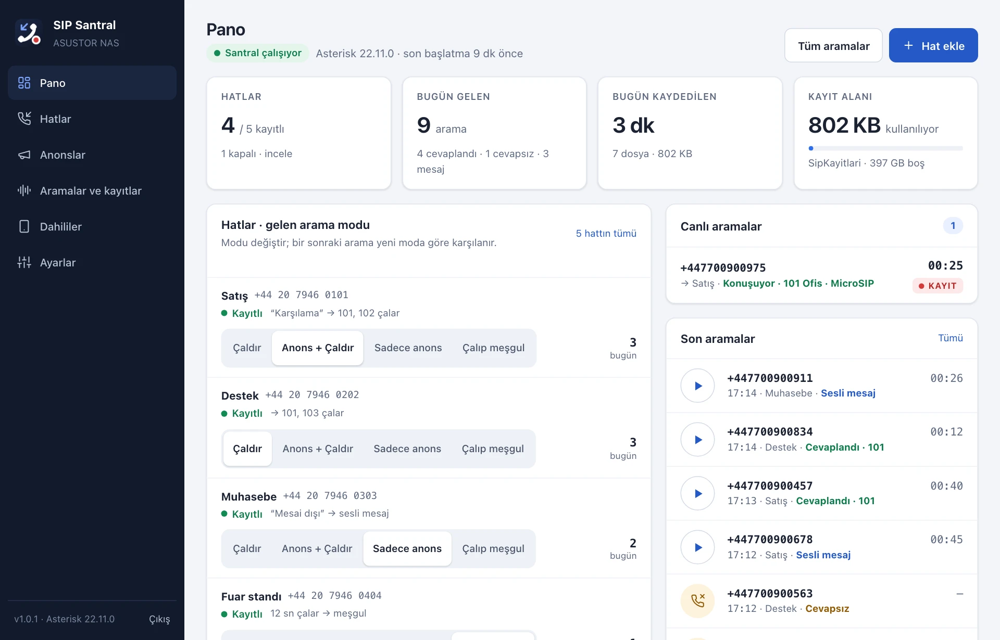
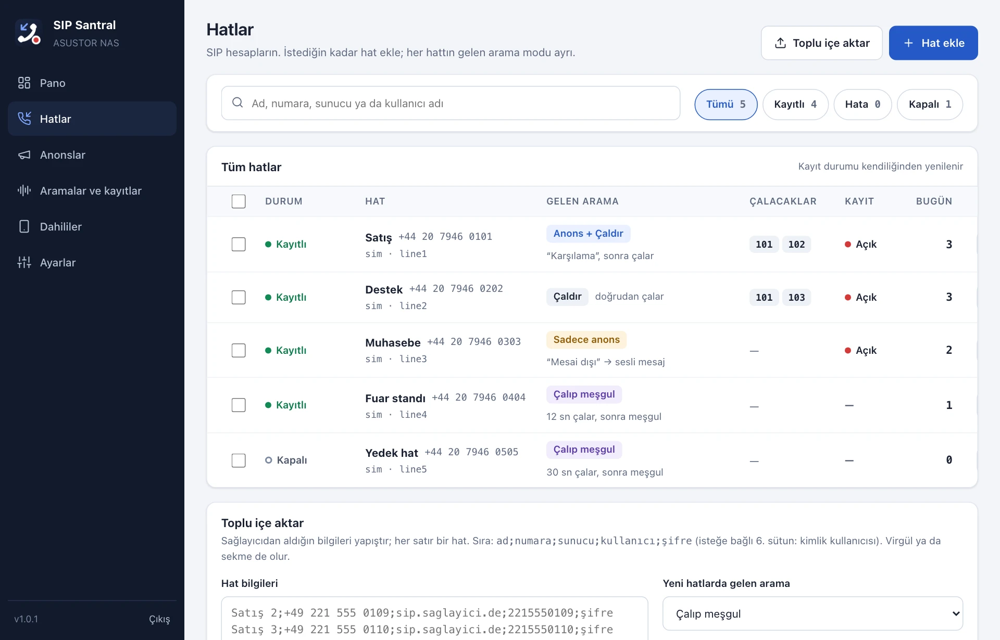
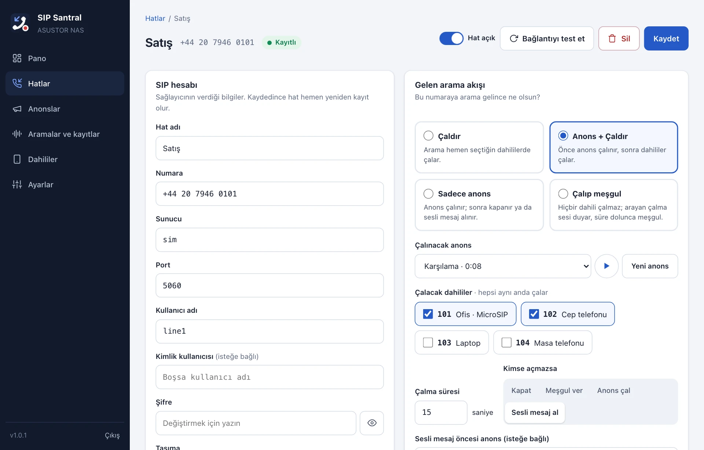
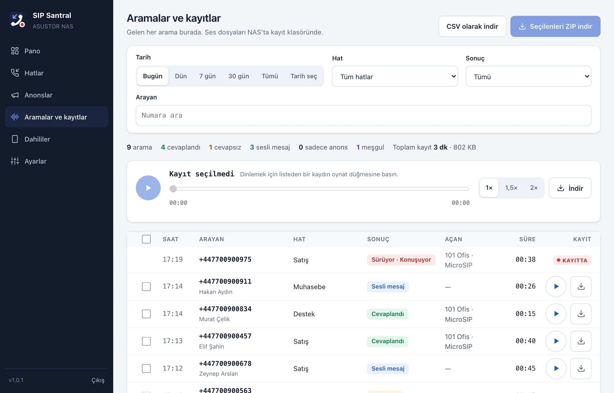
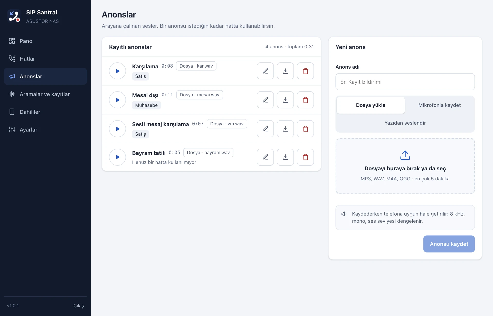
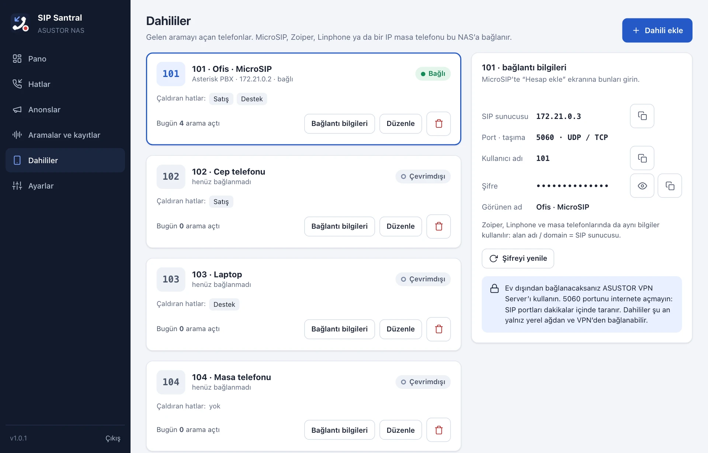
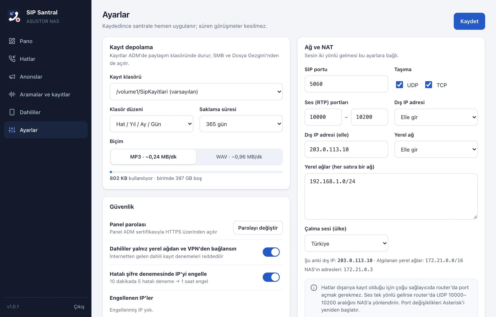
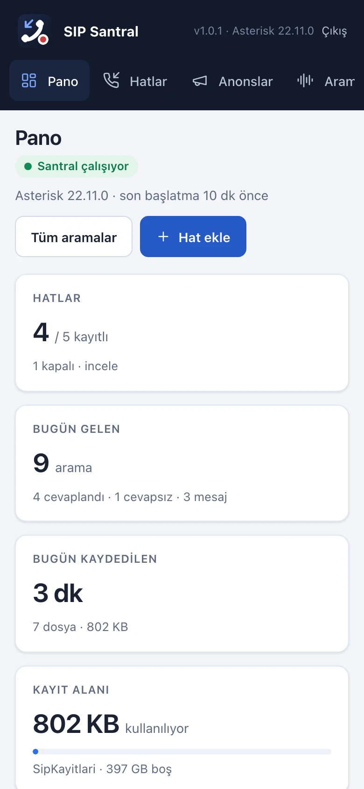

<p align="center">
  
</p>

<p align="center">
  <a href="https://github.com/kralldepo/Asustor_Sip_Santral/releases/latest"></a>
  
  
  
  
  <a href="LICENSE"></a>
</p>

<p align="center">
  <a href="README.md">Türkçe</a> · <b>English</b>
</p>

**SIP Santral** ("santral" is Turkish for PBX) is an App Central app that connects your SIP lines to an ASUSTOR NAS. For every line you decide what happens to an incoming call: ring your phones, play an announcement first, or play an announcement only and take a voicemail. Every answered call is recorded from start to end and stored in a shared folder on the NAS. Asterisk 22 ships inside the app, so **no Docker is needed**; installation is a single APK file.

> [!NOTE]
> The web interface is currently available in **Turkish only**. This guide gives the Turkish menu names together with their English meaning, e.g. *Hatlar* (Lines).

<picture>
  <source media="(prefers-color-scheme: dark)" srcset="docs/images/screenshots/dashboard-dark.webp">
  
</picture>

> [!IMPORTANT]
> Call recording is regulated in many countries (e.g. GDPR in the EU, §201 StGB in Germany, KVKK in Turkey, one- or two-party consent rules elsewhere). Tell callers that calls are recorded before you enable it, for example in the greeting: *"Calls may be recorded for quality purposes."* See [Disclaimer and legal notes](#disclaimer-and-legal-notes).

## Contents

- [Features](#features)
- [Screenshots](#screenshots)
- [How it works](#how-it-works)
- [Requirements](#requirements)
- [Installation](#installation)
- [Quick start](#quick-start)
- [Network and security](#network-and-security)
- [Updates, backup and removal](#updates-backup-and-removal)
- [Privacy](#privacy)
- [FAQ](#faq)
- [Building from source](#building-from-source)
- [Tests](#tests)
- [Project structure](#project-structure)
- [Disclaimer and legal notes](#disclaimer-and-legal-notes)
- [Third-party software](#third-party-software)
- [Contributing and security reports](#contributing-and-security-reports)
- [License](#license)

## Features

**Lines and incoming calls**

- Unlimited SIP lines, each with its own mode:
  - **Çaldır** (Ring): the selected extensions (MicroSIP, mobile, laptop, desk phone) ring at the same time.
  - **Anons + Çaldır** (Announcement + Ring): an announcement plays first, then the extensions ring.
  - **Sadece anons** (Announcement only): an announcement plays, then the call ends or a voicemail is taken.
  - **Çalıp meşgul** (Ring then busy): no extension rings; the caller hears ringback and gets a busy signal after a timeout (30 s by default). This is the default for new lines.
- If nobody answers: hang up, send busy, play an announcement or take a voicemail.
- Change a line's mode with one click on the dashboard; the next call follows the new mode.
- Bulk import of lines (`name;number;server;username;password`) plus bulk edit / enable / disable / delete on the lines screen.
- **Bağlantıyı test et** (Test connection) button, live registration status and readable error messages (e.g. wrong username or password).
- Advanced line settings: UDP/TCP, outbound proxy, from domain, codecs (G.722, G.711 a-law/µ-law), DTMF.

**Recordings and call history**

- Every answered call (conversation, announcement, voicemail) is recorded from start to end as MP3 (~0.24 MB/min) or WAV (~0.96 MB/min). Recording can be switched off per line.
- Recordings live in an ADM shared folder: `SipKayitlari/<Line>/<Year>/<Month>/<Day>/`, also reachable over SMB and File Explorer; the folder layout is configurable.
- Retention period (365 days by default); older recordings are deleted automatically.
- Live calls, call history with filters (date, line, result, number), in-browser playback (1× / 1.5× / 2×), download, CSV export and ZIP download of selected recordings.

**Announcements**

- File upload (MP3, WAV, M4A, OGG · up to 5 minutes), recording with the browser microphone, or text-to-speech.
- Text-to-speech runs on the NAS with [Piper](https://github.com/OHF-Voice/piper1-gpl); Turkish, German and English voices are downloaded on first use.
- Uploaded audio is converted for telephony (8 kHz, mono, level normalisation).

**Extensions**

- Connect MicroSIP, Zoiper, Linphone or any SIP desk phone.
- Strong passwords are generated automatically and can be copied from the *Bağlantı bilgileri* (Connection details) screen.
- Extensions can call each other; `*43` is an echo test. **There are no outgoing calls to external numbers**; the app is built for incoming calls.

**Security and administration**

- The panel is served over HTTPS with the ADM certificate; the password is stored with bcrypt, and 5 failed logins within 15 minutes lock the IP out for 10 minutes.
- By default, extensions may only connect from the local network and VPN.
- IP blocking after failed SIP authentication (5 attempts in 10 minutes → blocked for 1 hour).
- Settings backup download / restore, system log, SIP debugging.
- Turkish interface, light and dark themes, phone-friendly layout.

## Screenshots

> Taken from the real app with fictional demo data. Phone numbers come from ranges reserved for fiction. Images follow your GitHub light or dark theme.

<table>
  <tr>
    <td width="50%">
      <picture>
        <source media="(prefers-color-scheme: dark)" srcset="docs/images/screenshots/lines-dark.webp">
        
      </picture>
      <p align="center"><b>Lines</b>: status, mode and bulk actions</p>
    </td>
    <td width="50%">
      <picture>
        <source media="(prefers-color-scheme: dark)" srcset="docs/images/screenshots/line-edit-dark.webp">
        
      </picture>
      <p align="center"><b>Line settings</b>: SIP account and incoming call flow</p>
    </td>
  </tr>
  <tr>
    <td width="50%">
      <picture>
        <source media="(prefers-color-scheme: dark)" srcset="docs/images/screenshots/calls-dark.webp">
        
      </picture>
      <p align="center"><b>Calls and recordings</b>: filters, playback, CSV/ZIP</p>
    </td>
    <td width="50%">
      <picture>
        <source media="(prefers-color-scheme: dark)" srcset="docs/images/screenshots/announcements-dark.webp">
        
      </picture>
      <p align="center"><b>Announcements</b>: file, microphone or text-to-speech</p>
    </td>
  </tr>
  <tr>
    <td width="50%">
      <picture>
        <source media="(prefers-color-scheme: dark)" srcset="docs/images/screenshots/extensions-dark.webp">
        
      </picture>
      <p align="center"><b>Extensions</b>: connection details and status</p>
    </td>
    <td width="50%">
      <picture>
        <source media="(prefers-color-scheme: dark)" srcset="docs/images/screenshots/settings-dark.webp">
        
      </picture>
      <p align="center"><b>Settings</b>: storage, network/NAT, security</p>
    </td>
  </tr>
</table>

<details>
<summary>Phone layout</summary>
<p align="center">
  <picture>
    <source media="(prefers-color-scheme: dark)" srcset="docs/images/screenshots/mobile-dark.webp">
    
  </picture>
</p>
</details>

## How it works

<p align="center">
  
</p>

- `bin/sipsantral`: a single binary written in Go. Turkish web panel (HTTPS :9490, ADM certificate), Asterisk configuration generator, AMI client and recording processing.
- `rootfs.tar.gz`: an Alpine Linux (edge) arm64 root file system with Asterisk 22 (PJSIP), lame (MP3) and Piper (text-to-speech). On first start the panel unpacks it into `rootfs/` and runs Asterisk there in a **chroot**.
- Asterisk talks to the panel only through `127.0.0.1:5038` (AMI). On every change the panel regenerates `pjsip.conf` and `extensions.conf` and reloads Asterisk.
- Persistent data lives in `var/` (settings, call history, announcements, downloaded voices) and survives updates. Recordings stay in the shared folder and are not deleted when the app is removed.

<p align="center">
  
</p>

## Requirements

| | |
|---|---|
| **NAS** | ASUSTOR NAS with an ARM64 CPU (e.g. AS1104T). The prebuilt APK is ARM64 only; for x86-64 models [build from source](#building-from-source) (`./build.sh amd64`). |
| **ADM** | 4.0 or later |
| **SIP line** | An account from a SIP provider: server, username, password (and auth user if required) |
| **Disk** | APK ~52 MB. Each Piper voice ~63 MB. Recordings: MP3 ~0.24 MB/min, WAV ~0.96 MB/min |
| **Ports** | 9490 TCP (panel), 5060 UDP/TCP (SIP), 10000–10200 UDP (audio) |
| **Phone** | MicroSIP, Zoiper, Linphone or any SIP phone |

## Installation

1. Download `sipsantral_<version>_arm64.apk` from the [Releases](https://github.com/kralldepo/Asustor_Sip_Santral/releases/latest) page.
2. Optionally verify the file. The output must match the SHA-256 in the release notes:
   ```sh
   shasum -a 256 sipsantral_1.0.1_arm64.apk            # macOS
   sha256sum sipsantral_1.0.1_arm64.apk                # Linux
   Get-FileHash .\sipsantral_1.0.1_arm64.apk           # Windows PowerShell
   ```
3. In ADM open **App Central → Management → Manual Install**, select the APK and install it. ADM may warn about apps that do not come from App Central; confirm only if you trust the source.
4. Click the **SIP Santral** icon on the ADM desktop, or open `https://<nas-address>:9490` in your browser. If the NAS uses a self-signed certificate, the browser warns once.
5. On first start set the **panel password** (at least 8 characters). Because the Asterisk root file system is unpacked on the first run, the PBX may need a minute or two to come up.

Installation creates the `SipKayitlari` shared folder and registers ports 9490 and 5060 with ADM.

## Quick start

1. **Add an extension.** *Dahililer → Dahili ekle* (Extensions → Add extension). Leave the password empty to get a strong generated one.
2. **Connect a phone.** In MicroSIP, open *Add account* and enter the values from *Bağlantı bilgileri* (Connection details): SIP server = the NAS's local IP address, username = extension number, password = the one shown in the panel. Zoiper, Linphone and desk phones use the same values (domain = SIP server).
3. **Add a line.** *Hatlar → Hat ekle* (Lines → Add line). Enter the server, username, password and number from your provider. The line registers right after saving; check that the status shows **Kayıtlı** (Registered) or press *Bağlantıyı test et* (Test connection).
4. **Choose the flow.** Pick the line's mode, the extensions to ring, the ring time, what happens if nobody answers, and an announcement if needed.
5. **Try it.** Call your line's number from your mobile. The call shows up live on the *Pano* (Dashboard); afterwards you can play the recording under *Aramalar ve kayıtlar* (Calls and recordings).

To add many lines at once, paste one line per row into *Hatlar → Toplu içe aktar* (Lines → Bulk import):

```text
name;number;server;username;password[;auth user]
Sales;+44 20 7946 0101;sip.provider.example;442079460101;SecretPass1
Support;+44 20 7946 0202;sip.provider.example;442079460202;SecretPass2
```

Fields can be separated by `;`, `,` or tab; rows starting with `#` are ignored.

## Network and security

| Port | Protocol | Purpose | Expose to the internet? |
|---|---|---|---|
| 9490 | TCP | Web panel (HTTPS) | **No.** Use a VPN for remote access. |
| 5060 | UDP/TCP | SIP (extensions and provider) | **No.** Lines register outbound to the provider. |
| 10000–10200 | UDP | Audio (RTP) | Only if audio is one-way: forward this range to the NAS on your router. |

- **Do not expose port 5060 to the internet.** Open SIP ports are scanned within minutes, followed by password guessing and fraud attempts. Use ASUSTOR VPN Server for extensions outside your network.
- **Do not expose the panel to the internet.** It gives access to all line passwords and recordings.
- **External IP:** in *Ayarlar → Ağ ve NAT* (Settings → Network and NAT) choose automatic (via STUN every 10 minutes), manual or off. If audio is one-way, check this setting and RTP port forwarding first.
- Use a strong, unique panel password and protect your ADM admin account (2-step verification, up-to-date ADM).
- Keep *only allow extensions from the local network and VPN* and *block IPs after failed passwords* enabled (default).

## Updates, backup and removal

- **Update:** install the new APK the same way through *Manual Install*. Settings, call history, announcements and downloaded voices (`var/`) are kept; recordings stay in the shared folder.
- **Backup:** the *Ayarlar* (Settings) screen can download and restore a settings backup (JSON). The backup includes announcement audio but not the panel password.

  > [!WARNING]
  > The backup file contains SIP line passwords and extension passwords in **plain text**. Store it somewhere safe and never share it.

- **Removal:** uninstall from App Central. App files and settings are deleted; recordings in the `SipKayitlari` folder are **not** deleted. Delete that folder yourself if you no longer need it.

## Privacy

- The app sends no telemetry, usage statistics or recording data anywhere. Recordings, call history and settings stay on your NAS.
- While the external IP setting is *automatic*, the app sends a short request to STUN servers (`stun.l.google.com`, `stun.cloudflare.com`) every 10 minutes to learn the NAS's public IP address. Set the external IP to *manual* or *off* if you do not want this.
- Text-to-speech voices are downloaded from Hugging Face (`huggingface.co/rhasspy/piper-voices`) only when you download one. Speech is synthesised on the NAS; your text is not sent anywhere.
- Calls pass through the SIP provider you choose; your provider's privacy terms apply.
- Recordings contain personal data. Set the retention period to what you actually need and limit access to the recordings folder.

## FAQ

<details>
<summary><b>A line shows "Başarısız" (Failed).</b></summary>

Compare server, username and password with your provider's details; some providers need a separate auth user. The error reason on the line screen and the *Test connection* result point you in the right direction. Many failed attempts can get you temporarily blocked by the provider.
</details>

<details>
<summary><b>Audio is one-way or missing.</b></summary>

This is usually NAT. In *Settings → Network and NAT* check that the external IP is correct and the local networks are detected correctly. If the problem persists, forward UDP 10000–10200 to the NAS on your router.
</details>

<details>
<summary><b>My phone does not register as an extension.</b></summary>

Make sure the phone is on the same local network as the NAS (or on the VPN) and uses the NAS's local IP address as SIP server. Many failed passwords block the IP for 1 hour; you can lift the block under *Settings → Security*.
</details>

<details>
<summary><b>Can I make outgoing calls?</b></summary>

No. SIP Santral is designed to answer, route and record incoming calls. Extensions can only call each other. Do not rely on this system for emergency calls.
</details>

<details>
<summary><b>Where are recordings stored and how much space do they need?</b></summary>

The default location is the `/volume1/SipKayitlari` shared folder. MP3 needs about 0.24 MB per minute, WAV about 0.96 MB. Used and free space are shown on the dashboard and on the settings screen.
</details>

## Building from source

Requirements: [Go](https://go.dev/dl/) 1.26 or later, Docker (to build the root file system), macOS or Linux.

```sh
git clone https://github.com/kralldepo/Asustor_Sip_Santral.git
cd Asustor_Sip_Santral
./build.sh            # dist/sipsantral_<version>_arm64.apk  (ARM64 models, e.g. AS1104T)
./build.sh amd64      # x86-64 models (needs Docker with amd64 emulation)
```

- On the first build, `rootfs/build-rootfs.sh` creates `build/rootfs-<arch>.tar.gz` (~50 MB) with Docker. Delete that file to rebuild it.
- The version number is the `var version` variable in `main.go`.
- `tools/mkapk` packs the APK in ASUSTOR's APKG 2.0 format without needing root.

## Tests

```sh
go test ./...                                         # unit tests
GOOS=linux GOARCH=arm64 CGO_ENABLED=0 go build -o build/linux-arm64/sipsantral .
docker build -t ss-sim test/sim                       # fake provider + phone 101
go test -tags e2e -v -timeout 20m ./test/e2e          # end-to-end with real calls
docker run --rm --privileged -v "$PWD:/src:ro" alpine:3.22 sh /src/test/adm-sim.sh /src/dist/sipsantral_1.0.1_arm64.apk
```

- **End-to-end test:** line registration, extension registration, Ring / Announcement + Ring / Announcement only / voicemail / no answer / ring then busy flows, MP3 recordings, wrong-password detection, bulk actions, CSV/ZIP. With `KEEP=1 SS_UIDEV=1` the containers stay up and the UI is served live from `ui/` (http://127.0.0.1:19490, test password `testparola1`).
- **`adm-sim.sh`:** installs, upgrades and removes the APK the way ADM does, and checks that mounts are cleaned up and data is kept.

## Project structure

```text
.
├── main.go              # entry point, flags, HTTPS server
├── pbx.go               # Asterisk lifecycle, AMI events, line/extension status
├── astconf.go           # pjsip.conf / extensions.conf generation
├── ami.go               # Asterisk Manager Interface client
├── record.go            # recording processing, MP3 encoding, retention
├── calls.go             # call history (monthly JSONL)
├── store.go             # settings, lines, extensions, announcements
├── web.go, web_api.go   # web panel and REST API
├── tts.go, audio.go     # Piper text-to-speech, WAV handling
├── rootfs*.go           # root file system unpacking and chroot
├── ui/                  # Turkish web UI (HTML/CSS/JS, embedded in the binary)
├── package/CONTROL/     # App Central package metadata and lifecycle scripts
├── rootfs/              # Alpine + Asterisk root file system build (Docker)
├── tools/mkapk/         # APK packer
├── tools/icon/          # app icon generator (macOS, Swift)
├── test/                # end-to-end test, fake provider, ADM install simulation
└── docs/images/         # README images
```

## Disclaimer and legal notes

Short summary; read [DISCLAIMER.md](DISCLAIMER.md) for the full text.

- **No warranty.** The software is provided "as is" under the [MIT license](LICENSE). The authors are not liable for data loss, missed calls, service outages, phone bills or legal consequences arising from its use.
- **Call recording laws.** Whoever installs and operates the system is responsible for recording lawfully. Rules such as GDPR in the EU, §201 StGB in Germany or KVKK (Law No. 6698) in Turkey may require informing callers or obtaining consent. Keep recordings only as long as necessary and protect them from unauthorised access.
- **No emergency calls.** The system makes no outgoing calls and cannot reach 112, 911 or any other emergency number.
- **Security is your responsibility.** Securing the NAS, the network, ports and passwords is up to the operator. Misconfiguration can lead to unauthorised access and abuse of your SIP account.
- **Third-party services.** The terms of your SIP provider, ASUSTOR and Hugging Face apply.
- **Independent project.** This project is not affiliated with or endorsed by ASUSTOR Inc., Sangoma Technologies (Asterisk) or any other company mentioned. ASUSTOR, ADM and App Central are trademarks of ASUSTOR Inc.; Asterisk is a trademark of Sangoma Technologies. Other names belong to their owners.

## Third-party software

The APK contains open source components under their own licenses. The main ones:

| Component | License | Role |
|---|---|---|
| [Asterisk](https://www.asterisk.org) 22 | GPL-2.0 (with linking exception) | PBX engine |
| [PJSIP / pjproject](https://www.pjsip.org) | GPL-2.0-or-later | SIP stack |
| [Alpine Linux](https://alpinelinux.org) base packages, BusyBox, musl | GPL-2.0, MIT, others | Root file system |
| [LAME](https://lame.sourceforge.io) | LGPL-2.0-or-later | MP3 encoding |
| [Piper](https://github.com/OHF-Voice/piper1-gpl) | GPL-3.0 | Text-to-speech |
| [eSpeak NG](https://github.com/espeak-ng/espeak-ng) | GPL-3.0-or-later | Phonemization (Piper) |
| [ONNX Runtime](https://onnxruntime.ai) | MIT | Runs the voice model (Piper) |
| [golang.org/x/crypto](https://pkg.go.dev/golang.org/x/crypto) | BSD-3-Clause | bcrypt, root certificates |

Full list, versions and source code information: [THIRD_PARTY_NOTICES.md](THIRD_PARTY_NOTICES.md). Piper voice models are not distributed with the app; each model has its own license, so check the model card before commercial use.

## Contributing and security reports

- Use [Issues](https://github.com/kralldepo/Asustor_Sip_Santral/issues) for bugs and ideas. When reporting a bug, include your ADM version, NAS model and the output of *Ayarlar → Günlük* (Settings → Log) with passwords and phone numbers removed.
- Pull requests are welcome; run `go test ./...` before sending one.
- **Do not report security vulnerabilities in public issues.** See [SECURITY.md](SECURITY.md).

## License

[MIT](LICENSE) © 2026 kralldepo. Third-party components are subject to their own licenses; see [THIRD_PARTY_NOTICES.md](THIRD_PARTY_NOTICES.md).
