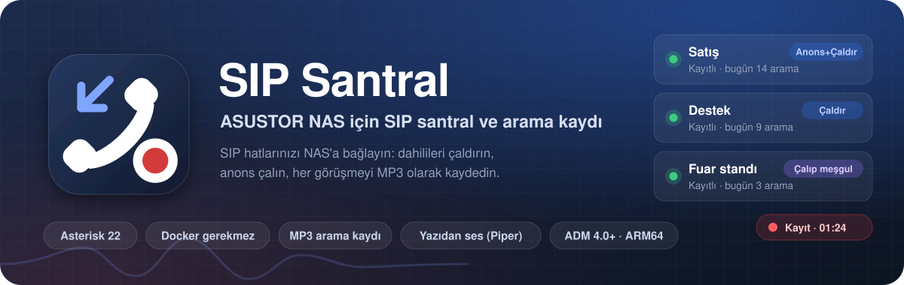
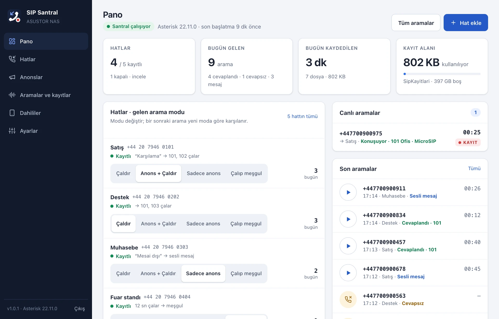
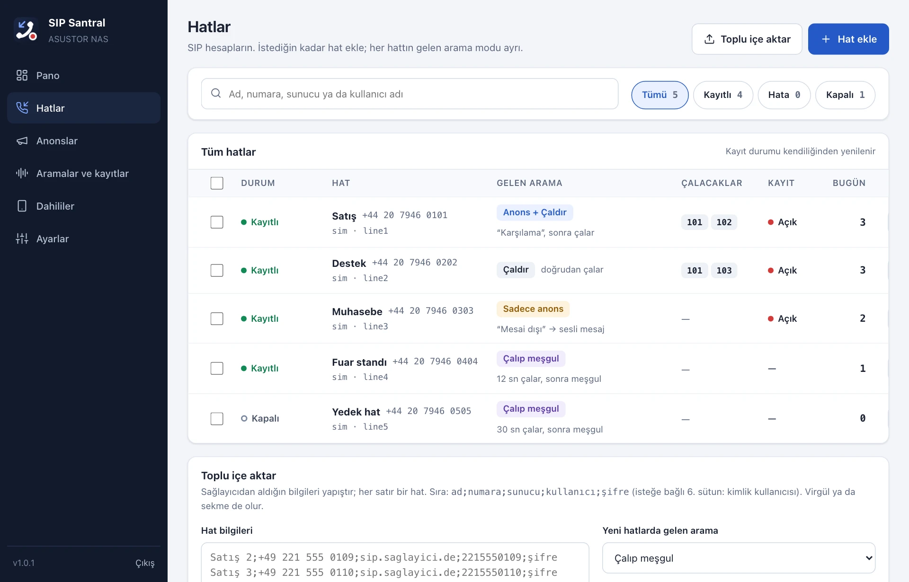
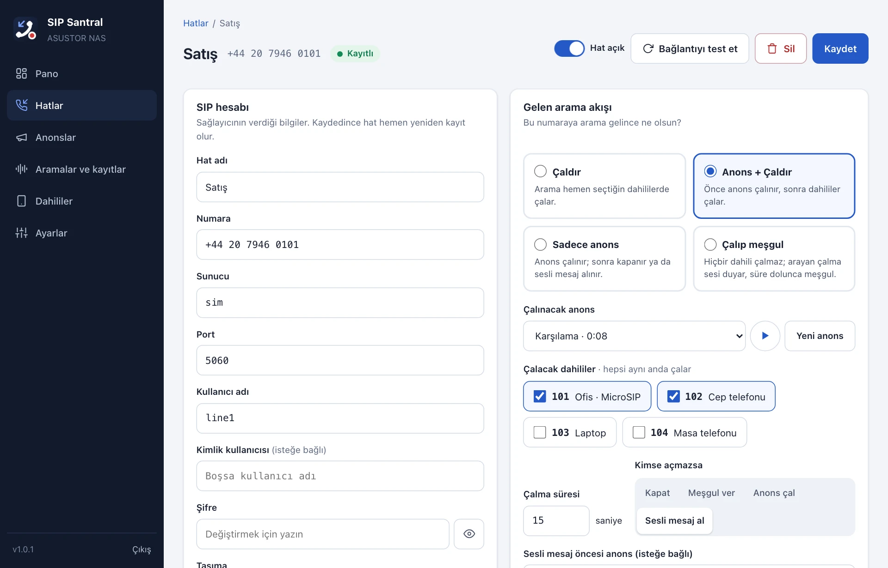
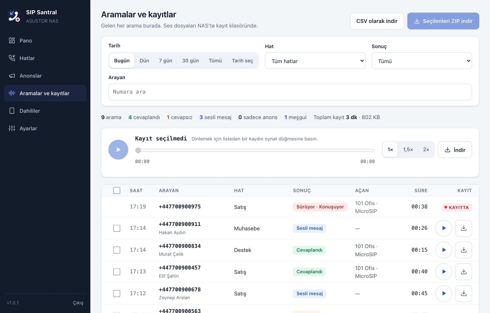
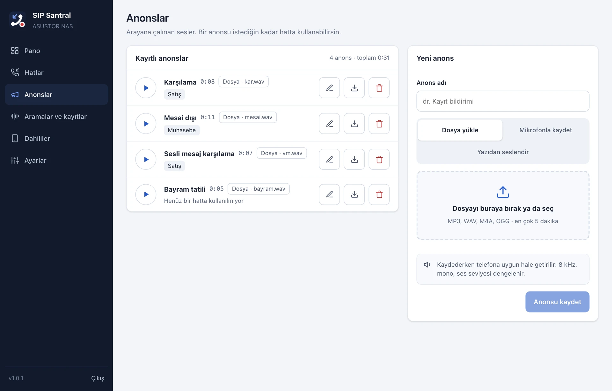
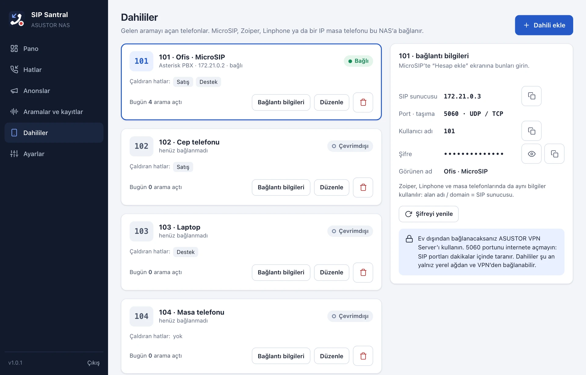
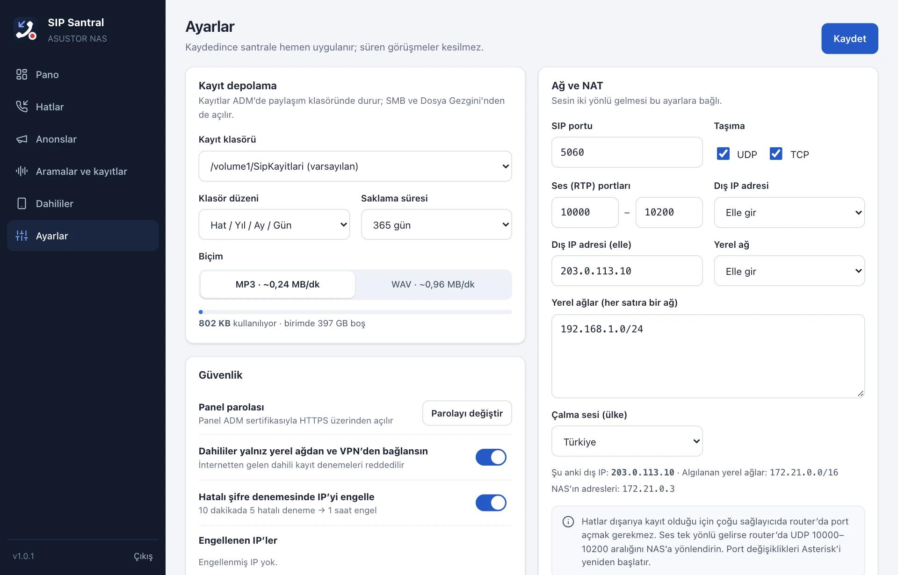
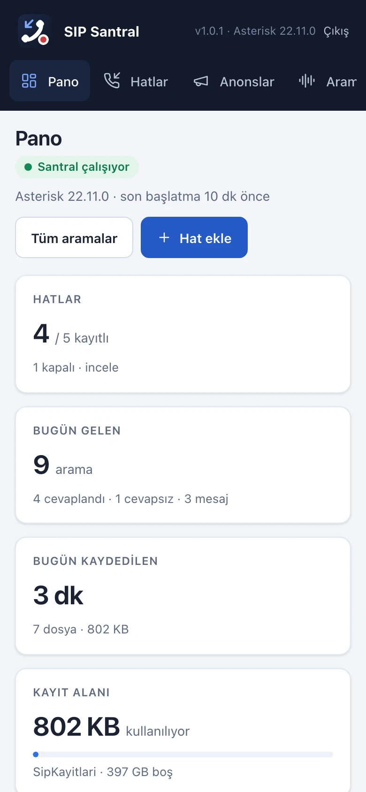

<p align="center">
  
</p>

<p align="center">
  <a href="https://github.com/kralldepo/Asustor_Sip_Santral/releases/latest"></a>
  
  
  
  
  <a href="LICENSE"></a>
</p>

<p align="center">
  <b>Türkçe</b> · <a href="README.en.md">English</a>
</p>

**SIP Santral**, SIP hatlarınızı ASUSTOR NAS'a bağlayan bir App Central uygulamasıdır. Her hat için gelen aramada ne olacağını siz seçersiniz: dahilileri çaldırın, önce anons çalın ya da yalnız anons çalıp sesli mesaj alın. Cevaplanan her görüşme baştan sona kaydedilir ve NAS'taki paylaşım klasöründe saklanır. Asterisk 22 uygulamanın içinde gelir; **Docker gerekmez**, kurulum tek bir APK dosyasıdır.

<picture>
  <source media="(prefers-color-scheme: dark)" srcset="docs/images/screenshots/dashboard-dark.webp">
  
</picture>

> [!IMPORTANT]
> Arama kaydı birçok ülkede yasal düzenlemeye tabidir (Türkiye'de KVKK, AB'de GDPR, Almanya'da ayrıca StGB §201). Kayıt açmadan önce arayanları bilgilendirin, örneğin karşılama anonsunda *"Görüşmeleriniz kalite amacıyla kayıt altına alınmaktadır"* deyin. Ayrıntılar: [Sorumluluk reddi ve yasal uyarılar](#sorumluluk-reddi-ve-yasal-uyarılar).

## İçindekiler

- [Özellikler](#özellikler)
- [Ekran görüntüleri](#ekran-görüntüleri)
- [Nasıl çalışır](#nasıl-çalışır)
- [Gereksinimler](#gereksinimler)
- [Kurulum](#kurulum)
- [Hızlı başlangıç](#hızlı-başlangıç)
- [Ağ ve güvenlik](#ağ-ve-güvenlik)
- [Güncelleme, yedek ve kaldırma](#güncelleme-yedek-ve-kaldırma)
- [Gizlilik](#gizlilik)
- [Sık sorulan sorular](#sık-sorulan-sorular)
- [Kaynaktan derleme](#kaynaktan-derleme)
- [Testler](#testler)
- [Proje yapısı](#proje-yapısı)
- [Sorumluluk reddi ve yasal uyarılar](#sorumluluk-reddi-ve-yasal-uyarılar)
- [Üçüncü taraf yazılımlar](#üçüncü-taraf-yazılımlar)
- [Katkı ve güvenlik bildirimi](#katkı-ve-güvenlik-bildirimi)
- [Lisans](#lisans)

## Özellikler

**Hatlar ve gelen arama**

- Sınırsız SIP hattı; her hattın kendi modu vardır:
  - **Çaldır**: seçili dahililer (MicroSIP, cep, laptop, masa telefonu) aynı anda çalar.
  - **Anons + Çaldır**: önce anons, sonra dahililer çalar.
  - **Sadece anons**: anons çalınır; ardından kapanır ya da sesli mesaj alınır.
  - **Çalıp meşgul**: hiçbir dahili çalmaz; arayan çalma sesi duyar, süre dolunca (varsayılan 30 sn) meşgul döner. Yeni hatların varsayılanı budur.
- Kimse açmazsa: kapat, meşgul ver, anons çal ya da sesli mesaj al.
- Panodan tek tıkla mod değiştirme; bir sonraki arama yeni moda göre karşılanır.
- Toplu hat içe aktarma (`ad;numara;sunucu;kullanıcı;şifre`) ve hatlar ekranında toplu düzenle / aç / kapat / sil.
- **Bağlantıyı test et** düğmesi, anlık kayıt durumu ve anlaşılır hata mesajları (ör. *Kullanıcı adı ya da şifre hatalı*).
- Gelişmiş hat ayarları: UDP/TCP, outbound proxy, from domain, codec (G.722, G.711 a-law/µ-law), DTMF.

**Kayıt ve arama geçmişi**

- Cevaplanan her arama (görüşme, anons, sesli mesaj) baştan sona kaydedilir: MP3 (~0,24 MB/dk) ya da WAV (~0,96 MB/dk). Kayıt hat bazında kapatılabilir.
- Kayıtlar ADM paylaşım klasöründe durur: `SipKayitlari/<Hat>/<Yıl>/<Ay>/<Gün>/`. SMB ve Dosya Gezgini ile de açılır; klasör düzeni değiştirilebilir.
- Saklama süresi (varsayılan 365 gün); süresi dolan kayıtlar kendiliğinden silinir.
- Canlı aramalar, arama geçmişi (tarih, hat, sonuç ve numara süzgeci), tarayıcıda dinleme (1× / 1,5× / 2×), indirme, CSV dışa aktarma ve seçilenleri ZIP indirme.

**Anonslar**

- Dosya yükleme (MP3, WAV, M4A, OGG · en çok 5 dakika), tarayıcıda mikrofonla kayıt ya da yazıdan seslendirme.
- Yazıdan seslendirme [Piper](https://github.com/OHF-Voice/piper1-gpl) ile NAS üzerinde çalışır; Türkçe, Almanca ve İngilizce sesler ilk kullanımda indirilir.
- Yüklenen ses telefona uygun hale getirilir (8 kHz, mono, seviye dengeleme).

**Dahililer**

- MicroSIP, Zoiper, Linphone ya da herhangi bir IP masa telefonu bağlanabilir.
- Güçlü şifre kendiliğinden üretilir; *Bağlantı bilgileri* ekranından tek tıkla kopyalanır.
- Dahililer birbirini arayabilir; `*43` yankı testidir. **Dışarıya (giden) arama yoktur**, uygulama gelen aramalar içindir.

**Güvenlik ve yönetim**

- Panel ADM sertifikasıyla HTTPS üzerinden açılır; parola bcrypt ile saklanır, 15 dakikada 5 hatalı girişte IP 10 dakika bekletilir.
- Dahililer varsayılan olarak yalnız yerel ağdan ve VPN'den bağlanır.
- Hatalı SIP şifre denemesinde IP engelleme (10 dakikada 5 deneme → 1 saat engel).
- Ayar yedeği indirme / geri yükleme, sistem günlüğü, SIP hata ayıklama.
- Türkçe arayüz, açık ve koyu tema, telefondan kullanıma uygun ekranlar.

## Ekran görüntüleri

> Görüntüler gerçek uygulamadan, kurgusal demo verisiyle alınmıştır. Numaralar kurgu amaçlı ayrılmış aralıklardandır; GitHub temanıza göre açık ya da koyu görünür.

<table>
  <tr>
    <td width="50%">
      <picture>
        <source media="(prefers-color-scheme: dark)" srcset="docs/images/screenshots/lines-dark.webp">
        
      </picture>
      <p align="center"><b>Hatlar</b>: durum, mod ve toplu işlemler</p>
    </td>
    <td width="50%">
      <picture>
        <source media="(prefers-color-scheme: dark)" srcset="docs/images/screenshots/line-edit-dark.webp">
        
      </picture>
      <p align="center"><b>Hat ayarları</b>: SIP hesabı ve gelen arama akışı</p>
    </td>
  </tr>
  <tr>
    <td width="50%">
      <picture>
        <source media="(prefers-color-scheme: dark)" srcset="docs/images/screenshots/calls-dark.webp">
        
      </picture>
      <p align="center"><b>Aramalar ve kayıtlar</b>: süzgeç, dinleme, CSV/ZIP</p>
    </td>
    <td width="50%">
      <picture>
        <source media="(prefers-color-scheme: dark)" srcset="docs/images/screenshots/announcements-dark.webp">
        
      </picture>
      <p align="center"><b>Anonslar</b>: dosya, mikrofon ya da yazıdan ses</p>
    </td>
  </tr>
  <tr>
    <td width="50%">
      <picture>
        <source media="(prefers-color-scheme: dark)" srcset="docs/images/screenshots/extensions-dark.webp">
        
      </picture>
      <p align="center"><b>Dahililer</b>: bağlantı bilgileri ve durum</p>
    </td>
    <td width="50%">
      <picture>
        <source media="(prefers-color-scheme: dark)" srcset="docs/images/screenshots/settings-dark.webp">
        
      </picture>
      <p align="center"><b>Ayarlar</b>: kayıt depolama, ağ/NAT, güvenlik</p>
    </td>
  </tr>
</table>

<details>
<summary>Telefon görünümü</summary>
<p align="center">
  <picture>
    <source media="(prefers-color-scheme: dark)" srcset="docs/images/screenshots/mobile-dark.webp">
    
  </picture>
</p>
</details>

## Nasıl çalışır

<p align="center">
  
</p>

- `bin/sipsantral`: Go ile yazılmış tek dosya. Türkçe web paneli (HTTPS :9490, ADM sertifikası), Asterisk ayar dosyalarının üretimi, AMI istemcisi ve kayıt işleme.
- `rootfs.tar.gz`: Alpine Linux (edge) arm64 kök dosya sistemi; içinde Asterisk 22 (PJSIP), lame (MP3) ve Piper (yazıdan ses) var. Panel ilk açılışta bunu `rootfs/` altına açar ve Asterisk'i orada **chroot** ile çalıştırır.
- Asterisk yalnız `127.0.0.1:5038` (AMI) üzerinden panelle konuşur. Panel her değişiklikte `pjsip.conf` ve `extensions.conf` dosyalarını yeniden üretir ve Asterisk'i yeniden yükler.
- Kalıcı veriler `var/` altındadır (ayarlar, arama geçmişi, anonslar, indirilen sesler) ve güncellemede korunur. Kayıtlar paylaşım klasöründe durur, uygulama kaldırılınca silinmez.

<p align="center">
  
</p>

## Gereksinimler

| | |
|---|---|
| **NAS** | ARM64 işlemcili ASUSTOR NAS (ör. AS1104T). Hazır APK yalnız ARM64 içindir; x86-64 modeller için [kaynaktan derleyin](#kaynaktan-derleme) (`./build.sh amd64`). |
| **ADM** | 4.0 ya da üzeri |
| **SIP hattı** | Bir SIP sağlayıcıdan alınmış hesap: sunucu, kullanıcı adı, şifre (ve varsa kimlik kullanıcısı) |
| **Disk** | APK ~52 MB. Her Piper sesi ~63 MB. Kayıt: MP3 ~0,24 MB/dk, WAV ~0,96 MB/dk |
| **Portlar** | 9490 TCP (panel), 5060 UDP/TCP (SIP), 10000–10200 UDP (ses) |
| **Telefon** | MicroSIP, Zoiper, Linphone ya da SIP destekli bir IP telefon |

## Kurulum

1. [Releases](https://github.com/kralldepo/Asustor_Sip_Santral/releases/latest) sayfasından `sipsantral_<sürüm>_arm64.apk` dosyasını indirin.
2. İsterseniz dosyayı doğrulayın. Çıkan değer, sürüm notlarındaki SHA-256 ile aynı olmalı:
   ```sh
   shasum -a 256 sipsantral_1.0.1_arm64.apk            # macOS
   sha256sum sipsantral_1.0.1_arm64.apk                # Linux
   Get-FileHash .\sipsantral_1.0.1_arm64.apk           # Windows PowerShell
   ```
3. ADM'de **App Central → Yönetim → Manuel Kurulum** yolunu açın, APK dosyasını seçin ve kurun. ADM, App Central dışından gelen uygulamalar için uyarı gösterebilir; uygulamanın kaynağına güveniyorsanız onaylayın.
4. ADM masaüstündeki **SIP Santral** simgesine tıklayın ya da tarayıcıda `https://<NAS-adresi>:9490` adresini açın. NAS kendinden imzalı sertifika kullanıyorsa tarayıcı bir kez uyarı gösterir.
5. İlk açılışta **panel parolasını** belirleyin (en az 8 karakter). İlk çalıştırmada Asterisk kök dosya sistemi açıldığı için santralin hazır olması bir iki dakika sürebilir.

Kurulum `SipKayitlari` paylaşım klasörünü oluşturur ve 9490, 5060 portlarını ADM'ye kaydeder.

## Hızlı başlangıç

1. **Dahili ekleyin.** *Dahililer → Dahili ekle*. Şifreyi boş bırakırsanız güçlü bir şifre üretilir.
2. **Telefonu bağlayın.** MicroSIP'te *Hesap ekle* ekranına *Bağlantı bilgileri*ndeki değerleri girin: SIP sunucusu = NAS'ın yerel IP adresi, kullanıcı adı = dahili numarası, şifre = paneldeki şifre. Zoiper, Linphone ve masa telefonlarında da aynı bilgiler kullanılır (alan adı / domain = SIP sunucusu).
3. **Hat ekleyin.** *Hatlar → Hat ekle*. Sağlayıcınızın verdiği sunucu, kullanıcı adı, şifre ve numarayı girin. Kaydedince hat hemen kayıt olur; durumun **Kayıtlı** olduğunu görün ya da *Bağlantıyı test et*'e basın.
4. **Akışı seçin.** Hattın modunu, çalacak dahilileri, çalma süresini, kimse açmazsa ne olacağını ve gerekirse anonsu seçin.
5. **Deneyin.** Hattınızın numarasını cep telefonunuzdan arayın. Arama *Pano*'da canlı görünür, bittikten sonra kaydı *Aramalar ve kayıtlar*da dinleyebilirsiniz.

Çok sayıda hattı tek seferde eklemek için *Hatlar → Toplu içe aktar* ekranına her satıra bir hat gelecek şekilde yapıştırın:

```text
ad;numara;sunucu;kullanıcı;şifre[;kimlik kullanıcısı]
Satış;+44 20 7946 0101;sip.saglayici.example;442079460101;GizliSifre1
Destek;+44 20 7946 0202;sip.saglayici.example;442079460202;GizliSifre2
```

Ayırıcı olarak `;`, `,` ya da sekme kullanılabilir; `#` ile başlayan satırlar yok sayılır.

## Ağ ve güvenlik

| Port | Protokol | Kullanım | İnternete açılmalı mı? |
|---|---|---|---|
| 9490 | TCP | Web paneli (HTTPS) | **Hayır.** Uzaktan erişim için VPN kullanın. |
| 5060 | UDP/TCP | SIP (dahililer ve sağlayıcı) | **Hayır.** Hatlar sağlayıcıya dışarıdan kayıt olur. |
| 10000–10200 | UDP | Ses (RTP) | Yalnız ses tek yönlü gelirse router'da NAS'a yönlendirin. |

- **5060 portunu internete açmayın.** Açık SIP portları dakikalar içinde taranır; şifre denemeleri ve dolandırıcılık girişimleri başlar. Evden ya da dışarıdan bağlanacak dahililer için ASUSTOR VPN Server kullanın.
- **Paneli internete açmayın.** Panel tüm hat şifrelerine ve kayıtlara erişim sağlar.
- **Dış IP:** *Ayarlar → Ağ ve NAT* bölümünden otomatik (STUN ile 10 dakikada bir), elle ya da kapalı seçilebilir. Ses tek yönlü geliyorsa önce bu ayarı ve RTP port yönlendirmesini kontrol edin.
- Güçlü ve benzersiz bir panel parolası kullanın; ADM yönetici hesabınızı da koruyun (2 adımlı doğrulama, güncel ADM).
- *Dahililer yalnız yerel ağdan ve VPN'den bağlansın* ve *Hatalı şifre denemesinde IP'yi engelle* seçeneklerini açık bırakın (varsayılan).

## Güncelleme, yedek ve kaldırma

- **Güncelleme:** Yeni APK'yı aynı şekilde *Manuel Kurulum* ile kurun. Ayarlar, arama geçmişi, anonslar ve indirilen sesler (`var/`) korunur; kayıtlar paylaşım klasöründe kalır.
- **Yedek:** *Ayarlar* ekranından ayar yedeği (JSON) indirilebilir ve geri yüklenebilir. Yedek anons seslerini de içerir, panel parolasını içermez.

  > [!WARNING]
  > Yedek dosyası SIP hat şifrelerini ve dahili şifrelerini **açık metin** olarak içerir. Güvenli bir yerde saklayın, kimseyle paylaşmayın.

- **Kaldırma:** App Central'dan kaldırın. Uygulama dosyaları ve ayarlar silinir; `SipKayitlari` klasöründeki kayıtlar **silinmez**. Gerekmiyorsa bu klasörü kendiniz silin.

## Gizlilik

- Uygulama telemetri, kullanım istatistiği ya da kayıt verisi göndermez. Kayıtlar, arama geçmişi ve ayarlar yalnız sizin NAS'ınızda durur.
- Dış IP ayarı *otomatik* iken uygulama, NAS'ın genel IP adresini öğrenmek için 10 dakikada bir STUN sunucularına (`stun.l.google.com`, `stun.cloudflare.com`) kısa bir istek gönderir. Bunu istemiyorsanız dış IP'yi *elle* ya da *kapalı* yapın.
- Yazıdan seslendirme sesleri yalnız siz indirdiğinizde Hugging Face'ten (`huggingface.co/rhasspy/piper-voices`) indirilir. Seslendirme NAS üzerinde yapılır; metniniz dışarı gönderilmez.
- Aramalar seçtiğiniz SIP sağlayıcısı üzerinden geçer; sağlayıcınızın gizlilik koşulları geçerlidir.
- Kayıtlar kişisel veri içerir. Saklama süresini ihtiyacınıza göre ayarlayın ve kayıt klasörüne yalnız yetkili kişilerin erişmesini sağlayın.

## Sık sorulan sorular

<details>
<summary><b>Hat "Başarısız" görünüyor.</b></summary>

Sunucu, kullanıcı adı ve şifreyi sağlayıcınızın bilgileriyle karşılaştırın; bazı sağlayıcılar ayrı bir *kimlik kullanıcısı* (auth user) ister. Hat ekranındaki hata nedeni ve *Bağlantıyı test et* sonucu yol gösterir. Çok sayıda hatalı deneme sağlayıcı tarafında geçici engele yol açabilir.
</details>

<details>
<summary><b>Ses tek yönlü geliyor ya da hiç gelmiyor.</b></summary>

Genellikle NAT ayarlarından kaynaklanır. *Ayarlar → Ağ ve NAT* bölümünde dış IP'nin doğru olduğunu ve yerel ağların doğru algılandığını kontrol edin. Sorun sürerse router'da UDP 10000–10200 aralığını NAS'a yönlendirin.
</details>

<details>
<summary><b>Telefonum dahili olarak bağlanmıyor.</b></summary>

Telefonun NAS ile aynı yerel ağda (ya da VPN'de) olduğundan, SIP sunucusu olarak NAS'ın yerel IP adresinin girildiğinden emin olun. Çok sayıda hatalı şifre denemesi IP'yi 1 saat engeller; engeli *Ayarlar → Güvenlik* bölümünden kaldırabilirsiniz.
</details>

<details>
<summary><b>Dışarıyı arayabilir miyim?</b></summary>

Hayır. SIP Santral gelen aramaları karşılamak, yönlendirmek ve kaydetmek için tasarlanmıştır. Dahililer yalnız birbirini arayabilir. Acil aramalar için bu sistemi kullanmayın.
</details>

<details>
<summary><b>Kayıtlar nerede ve ne kadar yer kaplar?</b></summary>

Varsayılan konum `/volume1/SipKayitlari` paylaşım klasörüdür. MP3 dakikada yaklaşık 0,24 MB, WAV yaklaşık 0,96 MB kaplar. Kullanılan ve boş alan *Pano* ile *Ayarlar* ekranlarında görünür.
</details>

## Kaynaktan derleme

Gerekenler: [Go](https://go.dev/dl/) 1.26 ya da üzeri, Docker (kök dosya sistemini üretmek için), macOS ya da Linux.

```sh
git clone https://github.com/kralldepo/Asustor_Sip_Santral.git
cd Asustor_Sip_Santral
./build.sh            # dist/sipsantral_<sürüm>_arm64.apk  (ARM64 modeller, ör. AS1104T)
./build.sh amd64      # x86-64 modeller (Docker'da amd64 öykünmesi gerekir)
```

- İlk derlemede `rootfs/build-rootfs.sh`, Docker ile `build/rootfs-<mimari>.tar.gz` dosyasını üretir (~50 MB). Yeniden üretmek için bu dosyayı silin.
- Sürüm numarası `main.go` içindeki `var version` değişkenidir.
- APK, `tools/mkapk` ile root yetkisi gerekmeden ASUSTOR APKG 2.0 biçiminde paketlenir.

## Testler

```sh
go test ./...                                         # birim testleri
GOOS=linux GOARCH=arm64 CGO_ENABLED=0 go build -o build/linux-arm64/sipsantral .
docker build -t ss-sim test/sim                       # sahte sağlayıcı + telefon 101
go test -tags e2e -v -timeout 20m ./test/e2e          # gerçek aramalarla uçtan uca
docker run --rm --privileged -v "$PWD:/src:ro" alpine:3.22 sh /src/test/adm-sim.sh /src/dist/sipsantral_1.0.1_arm64.apk
```

- **Uçtan uca test:** hat kaydı, dahili kaydı, Çaldır / Anons + Çaldır / Sadece anons / sesli mesaj / cevapsız / çalıp meşgul akışları, MP3 kayıtlar, hatalı şifre tespiti, toplu işlemler, CSV/ZIP. `KEEP=1 SS_UIDEV=1` ile kapsayıcılar açık kalır ve arayüz `ui/` klasöründen canlı sunulur (http://127.0.0.1:19490, test parolası `testparola1`).
- **`adm-sim.sh`:** APK'yı ADM gibi kurar, günceller, kaldırır; bağlamaların temizlendiğini ve verinin korunduğunu denetler.

## Proje yapısı

```text
.
├── main.go              # giriş noktası, bayraklar, HTTPS sunucusu
├── pbx.go               # Asterisk yaşam döngüsü, AMI olayları, hat/dahili durumu
├── astconf.go           # pjsip.conf / extensions.conf üretimi
├── ami.go               # Asterisk Manager Interface istemcisi
├── record.go            # kayıtların işlenmesi, MP3 dönüştürme, saklama süresi
├── calls.go             # arama geçmişi (aylık JSONL)
├── store.go             # ayarlar, hatlar, dahililer, anonslar
├── web.go, web_api.go   # web paneli ve REST API
├── tts.go, audio.go     # Piper yazıdan ses, WAV işleme
├── rootfs*.go           # kök dosya sistemini açma ve chroot
├── ui/                  # Türkçe web arayüzü (HTML/CSS/JS, ikili dosyaya gömülü)
├── package/CONTROL/     # App Central paket bilgileri ve yaşam döngüsü betikleri
├── rootfs/              # Alpine + Asterisk kök dosya sistemi üretimi (Docker)
├── tools/mkapk/         # APK paketleyici
├── tools/icon/          # uygulama simgesi üreticisi (macOS, Swift)
├── test/                # uçtan uca test, sahte sağlayıcı, ADM kurulum simülasyonu
└── docs/images/         # README görselleri
```

## Sorumluluk reddi ve yasal uyarılar

Kısa özet; tam metin için [DISCLAIMER.md](DISCLAIMER.md) dosyasını okuyun.

- **Garanti yoktur.** Yazılım [MIT lisansı](LICENSE) ile "olduğu gibi" sunulur. Kullanımdan doğan veri kaybı, kaçırılan arama, hizmet kesintisi, fatura ya da hukuki sonuçlardan geliştirici sorumlu tutulamaz.
- **Arama kaydı mevzuatı.** Kayıt yapmanın hukuki sorumluluğu sistemi kuran ve işletene aittir. Türkiye'de 6698 sayılı KVKK, AB'de GDPR, Almanya'da ayrıca StGB §201 gibi kurallar arayanın bilgilendirilmesini ya da onayını gerektirebilir. Kayıtları yalnız gerektiği kadar saklayın ve yetkisiz erişime karşı koruyun.
- **Acil aramalar desteklenmez.** Sistem giden arama yapmaz; 112 ya da başka acil numaralara ulaşmak için kullanılamaz.
- **Güvenlik sizin sorumluluğunuzdadır.** NAS'ın, ağın, portların ve şifrelerin güvenliği kurulumu yapana aittir. Yanlış yapılandırma yetkisiz erişime ve SIP hesabınızın kötüye kullanılmasına yol açabilir.
- **Üçüncü taraf hizmetler.** SIP sağlayıcınızın, ASUSTOR'un ve Hugging Face'in kendi kullanım koşulları geçerlidir.
- **Bağımsız proje.** Bu proje ASUSTOR Inc., Sangoma Technologies (Asterisk) ya da adı geçen diğer şirketlerle bağlantılı değildir, onlar tarafından onaylanmamıştır. ASUSTOR, ADM ve App Central, ASUSTOR Inc.'in; Asterisk, Sangoma Technologies'in ticari markalarıdır. Diğer adlar sahiplerine aittir.

## Üçüncü taraf yazılımlar

APK, kendi lisansları olan açık kaynak bileşenler içerir. Başlıcaları:

| Bileşen | Lisans | Görev |
|---|---|---|
| [Asterisk](https://www.asterisk.org) 22 | GPL-2.0 (bağlantı istisnasıyla) | Santral motoru |
| [PJSIP / pjproject](https://www.pjsip.org) | GPL-2.0-or-later | SIP yığını |
| [Alpine Linux](https://alpinelinux.org) temel paketleri, BusyBox, musl | GPL-2.0, MIT vb. | Kök dosya sistemi |
| [LAME](https://lame.sourceforge.io) | LGPL-2.0-or-later | MP3 kodlama |
| [Piper](https://github.com/OHF-Voice/piper1-gpl) | GPL-3.0 | Yazıdan ses |
| [eSpeak NG](https://github.com/espeak-ng/espeak-ng) | GPL-3.0-or-later | Fonem üretimi (Piper) |
| [ONNX Runtime](https://onnxruntime.ai) | MIT | Ses modelini çalıştırma (Piper) |
| [golang.org/x/crypto](https://pkg.go.dev/golang.org/x/crypto) | BSD-3-Clause | bcrypt, kök sertifikalar |

Tam liste, sürümler ve kaynak kod bilgisi: [THIRD_PARTY_NOTICES.md](THIRD_PARTY_NOTICES.md). Piper ses modelleri uygulamayla dağıtılmaz; her modelin kendi lisansı vardır, ticari kullanım öncesinde model kartını kontrol edin.

## Katkı ve güvenlik bildirimi

- Hata bildirimi ve öneriler için [Issues](https://github.com/kralldepo/Asustor_Sip_Santral/issues) bölümünü kullanın. Hata bildirirken ADM sürümünü, NAS modelini ve *Ayarlar → Günlük* çıktısını (şifre ve numaraları silerek) ekleyin.
- Pull request'ler memnuniyetle karşılanır; göndermeden önce `go test ./...` çalıştırın.
- **Güvenlik açıklarını herkese açık issue olarak bildirmeyin.** Yol için [SECURITY.md](SECURITY.md) dosyasına bakın.

## Lisans

[MIT](LICENSE) © 2026 kralldepo. Üçüncü taraf bileşenler kendi lisanslarına tabidir; bkz. [THIRD_PARTY_NOTICES.md](THIRD_PARTY_NOTICES.md).
